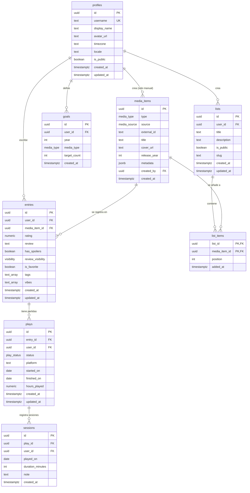

# Modelo de datos de Ludora

Modelo inicial de Postgres (Supabase) definido con Drizzle ORM. Está pensado para
juegos desde el primer día, pero es genérico para incorporar películas y series sin
cambiar la estructura: el catálogo usa `media_items` y el diario usa `entries`.

## Diagrama ER



## Tablas

### `profiles`
Perfil público vinculado 1:1 con `auth.users`. El `id` es el mismo UUID de Supabase
Auth y se borra en cascada cuando se elimina el usuario. `username` es único y debe
cumplir `^[a-z0-9_]{3,20}$`. `timezone` y `locale` tienen valores por defecto (`UTC`
y `es`).

### `media_items`
Catálogo genérico de juegos, películas y series. `type` distingue el medio, `source`
el origen (`rawg`, `tmdb`, `manual`) y `external_id` el identificador en la fuente.
Los ítems importados exigen `external_id`; los manuales no. La unicidad
`(source, external_id)` es parcial: solo aplica cuando `external_id` no es nulo, así
que pueden convivir varios ítems manuales sin identificador externo. `metadata` es
JSONB mínimo para plataformas y géneros. `created_by` solo se rellena en ítems
manuales.

### `entries`
Entrada del diario: relación única entre un usuario y un ítem del catálogo. Guarda la
calificación (`0.5` a `5.0` en pasos de `0.5`), la reseña (máximo 5000 caracteres),
visibilidad, spoilers, favorito y las etiquetas/vibras. Un usuario solo puede tener
una entrada por ítem (`UNIQUE (user_id, media_item_id)`).

### `plays`
Cada partida o visionado de una entrada. Permite rejugadas: una entrada puede tener
varias `plays`. El estado (`backlog`, `playing`, `completed`, `paused`, `dropped`) vive
aquí, no en `entries`. `started_on` y `finished_on` son opcionales, pero si existen
`finished_on` no puede ser anterior a `started_on`.

### `sessions`
Notas de sesión de una partida (Épica 6). Cada sesión pertenece a una `play` y tiene
fecha, duración positiva en minutos y una nota opcional.

### `goals`
Meta anual por usuario y tipo de contenido. Por defecto el tipo es `game`. La
combinación `(user_id, year, media_type)` es única y `target_count` debe ser positivo.

### `lists`
Listas personales de ítems del catálogo. El `slug` es único por usuario. `is_public`
queda en `false` por defecto; las lecturas públicas para anónimos se abordarán en la
Épica 9.

### `list_items`
Ítems dentro de una lista, con una PK compuesta `(list_id, media_item_id)` que evita
duplicados. `position` define el orden visible.

## Decisiones de diseño

- **`entries` vs `plays`**: `entries` representa la relación usuario-ítem y contiene
  la reseña; `plays` representa cada partida concreta. Separarlos permite rejugadas y
  estadísticas por partida sin duplicar reseñas.
- **Catálogo genérico**: `media_items` + `media_type` permiten reutilizar diario,
  listas y metas para juegos, películas y series.
- **Integridad por usuario con FKs compuestas**: `plays` referencia
  `entries(id, user_id)` y `sessions` referencia `plays(id, user_id)`. Así la base de
  datos garantiza que una partida o sesión nunca pertenece a un usuario distinto al de
  su padre. Para ello `entries` y `plays` exponen un `UNIQUE (id, user_id)`.
- **`created_by` con `ON DELETE SET NULL`**: si se borra el autor de un ítem manual,
  el ítem permanece en el catálogo (puede estar referenciado por entradas de otros
  usuarios) en lugar de borrarse en cascada.
- **`media_item_id` sin cascada**: borrar un ítem del catálogo con entradas o listas
  asociadas queda bloqueado por la FK. Es preferible a borrar entradas de usuarios de
  forma silenciosa.
- **`updated_at` con `$onUpdate`**: Drizzle actualiza la columna en sus propios
  `UPDATE`. No genera trigger en la base de datos; si se actualiza por SQL directo o
  desde Supabase Studio, `updated_at` no cambia. Si se necesita garantía a nivel de
  BD, habría que añadir un trigger con una migración custom.

## RLS

RLS está habilitada en las 8 tablas. Todas las políticas aplican al rol
`authenticated`; no hay políticas para `anon` todavía.

| Tabla | SELECT | INSERT | UPDATE | DELETE |
|---|---|---|---|---|
| `profiles` | fila propia o `is_public = true` | fila propia | fila propia | sin política (cascade desde `auth.users`) |
| `media_items` | cualquier autenticado | solo `source = 'manual'` y `created_by = auth.uid()` | solo manual propia | solo manual propia |
| `entries` | dueño | dueño | dueño | dueño |
| `plays` | dueño | dueño | dueño | dueño |
| `sessions` | dueño | dueño | dueño | dueño |
| `goals` | dueño | dueño | dueño | dueño |
| `lists` | dueño | dueño | dueño | dueño |
| `list_items` | dueño de la lista padre | dueño de la lista padre | dueño de la lista padre | dueño de la lista padre |

Las políticas usan `(select auth.uid())` en lugar de `auth.uid()` directo para que
Postgres pueda cachear el resultado por consulta.

> **Regla obligatoria:** la conexión de Drizzle usa un rol que se salta RLS (por
> ejemplo, el rol `postgres` o `service_role` de Supabase). Por tanto, **TODA query de
> servidor debe filtrar por el `user_id` de la sesión**. RLS protege el acceso con la
> anon key desde el cliente, pero no protege las consultas hechas con Drizzle.

## Migraciones

El esquema vive en `src/lib/db/schema/index.ts` y sus módulos. La configuración de
Drizzle Kit está en `drizzle.config.ts` y las migraciones se generan en `./drizzle`.

```bash
# Generar una migración a partir del esquema (no conecta a la base de datos)
pnpm db:generate

# Aplicar las migraciones pendientes (requiere DATABASE_URL real)
pnpm db:migrate
```

La migración inicial es `drizzle/0000_smooth_omega_sentinel.sql`. Incluye enums,
tablas, constraints, índices, FKs (incluida `REFERENCES auth.users(id)`),
`ENABLE ROW LEVEL SECURITY` y todas las políticas. Ya se aplicó al proyecto de
Supabase y quedó registrada en `drizzle.__drizzle_migrations`; se verificaron las 8
tablas con RLS activo y las 13 políticas. Para futuras migraciones, usa
`pnpm db:migrate`.
